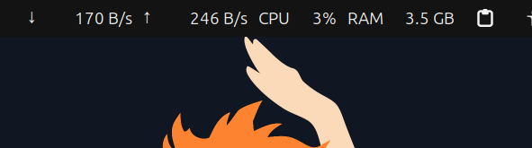
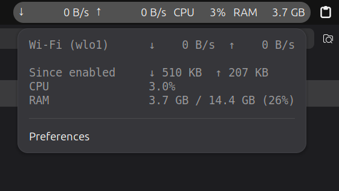

# AJ-NetUsage

A tiny GNOME Shell extension that shows your **live internet speed, CPU and RAM** right in the top bar.



Click it to see more:



- 100% local: reads Linux counters from `/proc`, no internet, no tracking, no dependencies
- Lightweight: one tiny read per second, never blocks your desktop
- Steady top bar: fixed-width values, so nothing jumps around
- Smart about VPNs and Docker: their traffic is not counted twice
- Settings window for refresh speed and what to show

Requires **GNOME Shell 50** (Ubuntu, Fedora, ...).

## Install

One command:

```sh
curl -fsSL https://raw.githubusercontent.com/abdallah-jasem/AJ-NetUsage/main/install.sh | bash
```

Then **log out and log back in**. GNOME on Wayland only loads new extensions at login.

<details>
<summary>Install from a clone instead</summary>

```sh
git clone https://github.com/abdallah-jasem/AJ-NetUsage.git
cd AJ-NetUsage
./install.sh
```

This links the folder into GNOME, so `git pull` + log out/in updates it.
</details>

## Update

Run the same install command again, then log out and back in.

## Settings

Click the indicator → **Preferences**, or run:

```sh
gnome-extensions prefs aj-netusage@local
```

| Setting | Default | What it does |
|---|---|---|
| Refresh interval | 1 s | How often numbers update (1-10 s) |
| Show CPU | on | CPU % in the top bar |
| Show RAM | on | RAM in the top bar |
| Ignored interface prefixes | lo, docker, veth, br-, virbr, tun, tap, wg, proton, ipv6leakintrf | Interfaces left out of the totals. VPN and virtual interfaces carry traffic that already went through your real Wi-Fi/Ethernet card. They still show in the popup (marked `*`) when active |

## Uninstall

```sh
gnome-extensions disable aj-netusage@local
rm -rf ~/.local/share/gnome-shell/extensions/aj-netusage@local
```

## How it works

Every second the extension reads three files the Linux kernel keeps in memory:

| File | Gives | Calculation |
|---|---|---|
| `/proc/net/dev` | total bytes received/sent per interface | speed = (now - before) / seconds passed |
| `/proc/stat` | CPU busy/idle time | CPU % = 1 - idle change / total change |
| `/proc/meminfo` | memory | used = MemTotal - MemAvailable |

## Development

```
metadata.json      UUID, name, shell-version, settings schema
extension.js       enable/disable lifecycle, timer, glue
prefs.js           preferences window (Adwaita)
src/network.js     parse /proc/net/dev, speeds, friendly interface names
src/cpu.js         CPU % from /proc/stat
src/memory.js      RAM from /proc/meminfo
src/format.js      bytes -> "1.2 MB"
src/indicator.js   top bar button + popup
schemas/           settings (GSettings) schema
stylesheet.css     top bar widths and fonts
test.js            unit checks for the pure modules
install.sh         installer
```

```sh
gjs -m test.js                              # unit checks
dbus-run-session gnome-shell --devkit       # test in a nested GNOME window, no logout needed
journalctl -f -o cat /usr/bin/gnome-shell   # logs
glib-compile-schemas schemas/               # after editing the schema
```

Package a zip:

```sh
gnome-extensions pack --extra-source=src --extra-source=README.md
```
